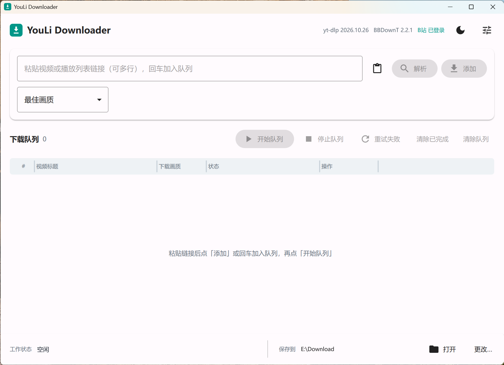
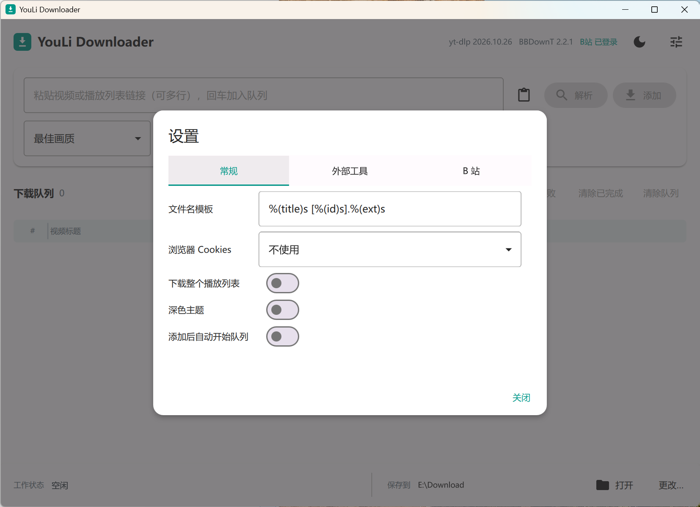

# YouLi Downloader

[](https://github.com/Steinadler177/YouLi-Downloader/releases/latest)
[](https://github.com/Steinadler177/YouLi-Downloader/releases/latest)
[](LICENSE)

基于 [yt-dlp](https://github.com/yt-dlp/yt-dlp) 与 [BBDownT](https://github.com/LOVAHE/BBDownT) 的 Windows 下载器图形界面（PySide6 + QML Material）。  
一般网站走 yt-dlp，B 站链接走 BBDownT；外部工具可单独更新，不必重新打包。

A Windows GUI downloader for yt-dlp and BBDownT (PySide6 + QML Material).

## 功能

- 通用站点用 yt-dlp，B 站自动切换 BBDownT
- 多行粘贴 / 拖入批量入队，顺序分析与下载
- 播放列表 / B 站多 P 分析后展开为多条任务，保存到子文件夹
- 画质预设、浏览器 Cookies、B 站扫码登录（会员清晰度）
- 队列恢复（`queue.json`）、添加入队后可自动开始
- 一键打包成免安装文件夹，可拷到其他电脑使用

## 截图

| 主界面 | 设置 |
| :-: | :-: |
|  |  |

## 运行

**双击 `start.bat`**。首次会自动创建 `.venv` 并安装依赖（有 uv 用 uv，否则用 py/pip），之后直接启动。

```bash
uv venv --python 3.13 .venv
uv pip install --python .venv/Scripts/python.exe -r requirements.txt
.venv/Scripts/python.exe run.pyw
```

首次若没有 `bin/yt-dlp.exe` / `bin/BBDownT.exe`，在 **设置 → 外部工具 / B 站** 点对应“下载”；ffmpeg 放进 `bin/` 或系统 PATH。  
B 站会员清晰度：顶栏「B站 未登录」，或 **设置 → B 站 → 扫码登录**。

## 打包

**双击 `build.bat`**，输出 `dist\YouLiDownloader\`：

```
dist\YouLiDownloader\
  YouLiDownloader.exe
  _internal\            Python + Qt（约 112 MB）
  bin\                  yt-dlp / BBDownT / ffmpeg（不含登录 Cookie）
```

- 整夹可直接拷走，无需安装 Python。
- 打包版有独立的 `config.json` / `BBDownT.data`，与源码版互不影响。
- 必须在 `.venv-build`（PySide6-Essentials）里打包；用完整 PySide6 会多带约 200 MB 的 QtWebEngine。

## 结构

```
bin/                    外部工具（可单独替换）
app/
  main.py               入口
  core/                 无界面逻辑（配置、命令、队列、BBDownT、更新）
  models/task_model.py  队列表模型
  bridge/backend.py     QML 入口 `backend`
  ui/                   纯 QML（Main、UrlCard、QueueRow、SettingsDialog…）
```

## 与 yt-dlp / BBDownT

**yt-dlp**

- 进度：`--progress-template "download:[progress]%(progress)j"`
- 最终路径：`--print after_move:[done]%(filepath)s`
- 分析：`-J --flat-playlist`；单条下载 `--no-playlist`
- 取消：`taskkill /T /F` 结束进程树

**BBDownT**

- 重定向时不打印进度 → 下载走 `serve` HTTP API（随机端口）
- 分析：`BBDownT <url> -info`；多 P 用 `SelectPage=N`
- 取消：结束服务进程（不支持单任务取消），下一任务自动重启
- 「仅音频 MP3」：先下 m4a，再 ffmpeg 转 mp3

## 免责声明

- 仅供学习与个人备份。请遵守当地法律与各站点服务条款；不要下载无权获取的内容。
- 使用后果由使用者自行承担；作者不对版权纠纷、账号风控、数据丢失或间接损失负责。
- 本项目**不**捆绑 Cookie / 登录凭证。`bin/BBDownT.data` 等为本地敏感数据，请勿上传或分享。
- 上游工具行为（风控、清晰度、协议变更等）以其项目为准；本 GUI 只做调用与队列管理。

For learning and personal backup only. Comply with local laws and site Terms of Service. Use at your own risk; authors are not liable for copyright disputes, account restrictions, or data loss. This project does **not** distribute cookies or login credentials.

## 许可证

源代码以 **MIT License** 发布，见 [`LICENSE`](LICENSE)。

| 组件 | 用途 | 许可说明 |
| --- | --- | --- |
| [yt-dlp](https://github.com/yt-dlp/yt-dlp) | 通用下载 | Unlicense（官方 exe 打包可能另含 GPLv3+ 等） |
| [BBDownT](https://github.com/LOVAHE/BBDownT) | B 站下载 | 以上游及其前身 BBDown 为准 |
| ffmpeg | 合并 / 转码 | 取决于你使用的构建 |
| PySide6 / Qt | GUI | LGPL / 商业许可；分发二进制时请自行满足 LGPL 义务 |

仓库**不**纳入上述 exe；请从各自官方发布页获取。
